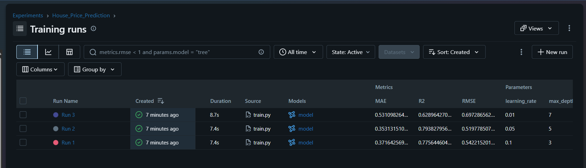

# House Price Prediction - MLflow Tracking

## 1. Task Description

This project trains a Gradient Boosting Regressor on the California Housing dataset to predict house prices. We use MLflow to track three different experiments with varying hyperparameters (`max_depth` and `learning_rate`) to identify the best-performing configuration.

## 2. How to Run the Project

1. Create and activate a Python virtual environment.
2. Install the required dependencies: `pip install -r requirements.txt`
3. Run the training script: `python train.py`
4. Launch the MLflow UI to view results: `mlflow ui --host 127.0.0.1 --port 8080`

## 3. Experiment Results

## 4. Comparison Table

| Run   | Max Depth | Learning Rate | RMSE   | MAE  | R2   |
| ----- | --------- | ------------- | ------ | ---- | ---- |
| Run 1 | 3         | 0.10          | 0.5422 | 0.37 | 0.78 |
| Run 2 | 5         | 0.05          | 0.5198 | 0.35 | 0.79 |
| Run 3 | 7         | 0.01          | 0.6973 | 0.53 | 0.63 |

## 5. Selected Best Model

Run 2

## 6. Explanation

Run 2 best model because it achieved the lowest Root Mean Squared Error (RMSE) score of 0.5198 on the validation data.
